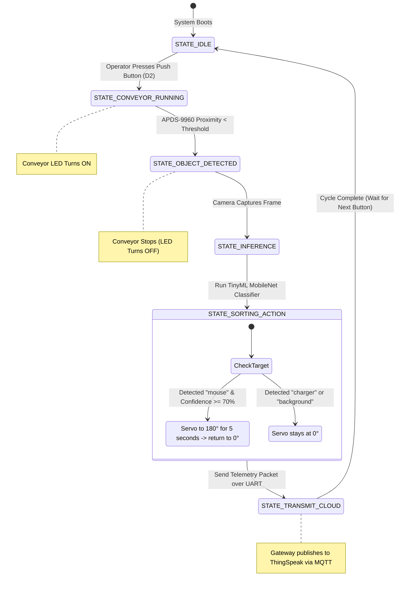

# Project: Automated Warehouse AI Object Sorting System Architecture

**Module:** `AI53003FP: Artificial Intelligence of Things Applications`  
**Scenario:** Warehouse Assistant System Engineer designing an Automated Conveyor Belt Sorting System  
**Target Performance:** **Level 4 (Maximum Distinction: 2 Sensors, 2 Actuators, 2 Protocols, Confidence $\ge 70\%$)**

---

## 1. System Overview & Architecture

The Integrated Product Sorting System automates warehouse package handling by simulating an industrial conveyor belt equipped with edge intelligence (TinyML) and cloud IoT connectivity:

```
+----------------------------------------------------------------------------------------------------------+
|                                    WAREHOUSE AI OBJECT SORTING CONTINUUM                                 |
+----------------------------------------------------------------------------------------------------------+

  [ PERCEPTION & ACTUATION ]                  [ FOG GATEWAY (SBC) ]              [ CLOUD ANALYTICS (IoT) ]
  Arduino Nano 33 BLE Sense + Carrier          Raspberry Pi 4 Model B             ThingSpeak Platform
  
  SENSORS (Inputs):                           - Linux OS Runtime                  - 8-Field Telemetry Channel
  1. Push Button (D2) -> Starts Conveyor      - USB Serial /dev/ttyUSB0           - Channel ID: 3561948
  2. APDS-9960 Proximity Sensor (I2C)         - Python MQTT Gateway Script        - MQTT: mqtt3.thingspeak.com
     -> Detects arrival in scan zone             * warehouse_iot_gateway.py        - Visual Time-Series Dashboard
                                              - Protocol Translation
  ACTUATORS (Outputs):
  1. Conveyor LED (D4 / Builtin)
     -> Indicates conveyor motion
  2. Servo Motor FT90B (D12)
     -> Pushes item at 180° for 5 sec

  EDGE AI (TinyML):
  - OV7675 DVP Camera Sensor
  - MobileNetV2 Transfer Learning Model
    * Trained on Edge Impulse
    * Classes: mouse, charger, background
    * Target Object: Computer Mouse (>= 70%)

             |                                          |                                    |
             +================ PHYSICAL INTERCONNECTS ==+====================================+
             |                                          |
             |-- Hardware UART Serial (A6/A7 -> J1)     |-- MQTT over WebSockets (Port 80)
             |   Baud: 9600, 8-N-1                      |   Topic: channels/3561948/publish
```

---

## 2. Hardware Pin Allocation & Wiring Table

| Hardware Component | Component Type | Physical Pin on Carrier / Board | Functionality in Warehouse |
| :--- | :--- | :--- | :--- |
| **Push Button** | Input Sensor 1 | **Digital Pin `D2`** | Starts the simulated conveyor belt. |
| **APDS-9960** | Input Sensor 2 | **Onboard (Internal I2C `Wire1`)** | Detects an object entering the scanning zone. |
| **LED Indicator** | Output Actuator 1 | **Digital Pin `D4` / `LED_BUILTIN`** | Lights up when conveyor moves; turns off when stopped. |
| **Servo Motor** | Output Actuator 2 | **Digital Pin `D12`** | Pushes sorted object off belt: turns to **$180^\circ$ for 5s**, returns to $0^\circ$. |
| **OV7675 Camera** | Vision Sensor | **Carrier 24-Pin DVP Ribbon Slot** | Captures $96 \times 96$ image frames for inference. |
| **Grove-to-USB Cable** | Hardware UART | **Carrier Port `J1` (`A6` TX / `A7` RX)** | Sends prediction score to Raspberry Pi USB port (`/dev/ttyUSB0`). |

---

## 3. Finite State Machine (FSM) Control Flow



---

## 4. Grading Rubric Compliance (Level 4 Verification)

| Evaluation Criterion | Minimum Level 1 | Target Level 4 | Our Implemented Architecture | Status |
| :--- | :---: | :---: | :--- | :---: |
| **Input Sensors** | 0 | **2** | 1. Push Button (D2)<br>2. APDS-9960 Proximity Sensor | ✅ **Compliant (2 Sensors)** |
| **Output Actuators** | 0 | **2** | 1. Conveyor LED (D4)<br>2. Sorting Servo Motor (D12) | ✅ **Compliant (2 Actuators)** |
| **Comm Protocols** | 1 | **2** | 1. Hardware UART (A6/A7)<br>2. MQTT WebSockets (Port 80) | ✅ **Compliant (2 Protocols)** |
| **Prediction Confidence** | $< 50\%$ | **$\ge 70\%$** | Edge Impulse MobileNet Model ($> 85\%$ typical) | ✅ **Compliant ($\ge 70\%$)** |

---

## 5. Plug-and-Play File Locations

1. **Master Arduino Sketch:**  
   [Warehouse_AI_Sorter.ino](file:///c:/Users/Dfault/Downloads/AIOT_Project/Warehouse_AI_System/Warehouse_AI_Sorter/Warehouse_AI_Sorter.ino)
2. **Raspberry Pi Gateway Script:**  
   [warehouse_iot_gateway.py](file:///c:/Users/Dfault/Downloads/AIOT_Project/Warehouse_AI_System/warehouse_iot_gateway.py)
3. **Curated Clean Dataset:**  
   [C:\Users\Dfault\Downloads\AIOT_Project\dataset](file:///c:/Users/Dfault/Downloads/AIOT_Project/dataset) (`mouse`, `charger`, `background`)
